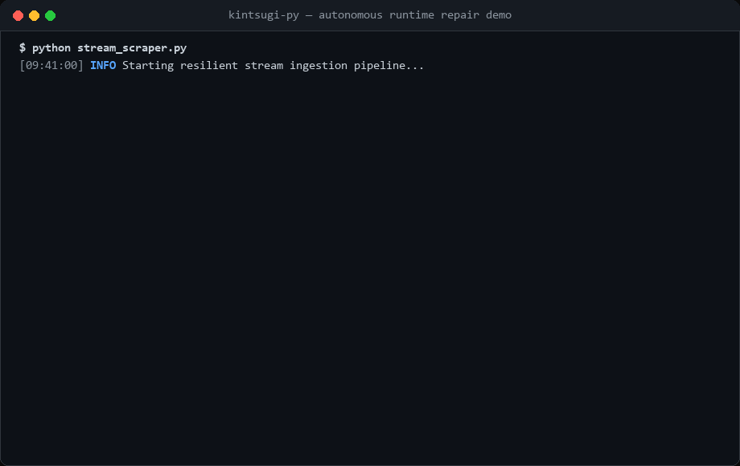

# KintsugiPy (金継ぎ)

> **"Treat breakage and repair as part of an application's history, rather than a catastrophic failure."**

[](https://github.com/zakyirhab/kintsugi-py/actions/workflows/ci.yml)
[](https://pypi.org/project/kintsugi-py/)
[](https://pypi.org/project/kintsugi-py/)
[](https://github.com/zakyirhab/kintsugi-py/blob/main/LICENSE)
[]()

<p align="center">
  
</p>

**KintsugiPy** is an autonomous, self-healing runtime engine for Python functions powered by Universal LLMs. When a function encounters an unhandled exception or upstream schema drift (e.g. web scraping layout changes, third-party API mutations, malformed dirty payloads), KintsugiPy:

1. **Captures Crime Scene Telemetry**: Extracts function AST source, local variables, traceback, and execution context.
2. **Generates Surgical Patches**: Calls your LLM of choice (Local, Groq, OpenAI, Anthropic, Gemini, DeepSeek, OpenRouter).
3. **AST Safety Guardrail**: Evaluates candidate patches against strict security policies—blocking dangerous imports (`os`, `sys`, `subprocess`, `shutil`) and builtins (`eval`, `exec`, `open`).
4. **Validates Output Contracts**: Dry-runs the patch against original failing inputs and verifies return types using **Pydantic v2**.
5. **In-Memory Hot-Swapping**: Swaps the active callable pointer in place. Future calls run the repaired code natively with **zero LLM latency**.
6. **Disk Cache Persistence**: Persists validated patches to `.kintsugi_cache/` for zero-token cold start rehydration across process restarts.

---

## ⚡ Key Highlights

- **Zero Heavy Vendor SDKs**: Engineered cleanly on top of `httpx` and `pydantic`. No bloated 500MB cloud client packages.
- **Thundering Herd Concurrency Shield**: Built-in **Double-Checked Locking** (`asyncio.Lock` & `threading.Lock`). When 50 concurrent tasks fail simultaneously in `asyncio.gather()`, exactly **1** LLM repair call is made—the other 49 tasks wait and seamlessly reuse the hot-swapped function.
- **Rich Observability Telemetry**: Inspect runtime repairs with `HealReport`, providing unified git-style code diffs, root-cause tracebacks, attempt counts, and provider metadata.
- **AST-Aware Caching & Stale Pruning**: Ignores comments and whitespace variations when hashing, avoiding false cache invalidations. Obsolete patch versions are automatically cleaned up from `.kintsugi_cache/`.
- **Universal Provider Engine**: Direct REST wire adapters for Anthropic (`/v1/messages`), Google Gemini (`generateContent`), OpenAI-compatible endpoints (`/v1/chat/completions`), and local runtimes (LM Studio, Ollama, vLLM).
- **Multi-Provider Fallback Chain**: Automatically cascade from Local LLM $\rightarrow$ Groq $\rightarrow$ Claude $\rightarrow$ OpenAI if an endpoint is unreachable or rate-limited.
- **Zero Overhead on Normal Execution**: Healthy function invocations run at native Python C-speed.
- **Dual Sync & Async Core**: Seamlessly heals standard functions (`def`) and asynchronous coroutines (`async def`).

---

## 📦 Installation

```bash
# Using pip
pip install kintsugi-py

# Using uv
uv add kintsugi-py

# Using poetry
poetry add kintsugi-py
```

---

## 🚀 Quickstart

### 1. Basic Usage (Zero Configuration Auto-Detection)

Set an API key in your environment (or pass it directly):

```bash
export GROQ_API_KEY="gsk_..."
```

Decorate your brittle function with `@heal`:

```python
from kintsugi import heal

@heal()
def parse_price(data: dict) -> int:
    # Fragile code expects int under 'price' key
    return data["price"]

# Normal call passes natively
print(parse_price({"price": 100}))  # 100

# Upstream payload breaks: key changed to 'cost' with currency string!
# Kintsugi intercepts the KeyError, heals the function, and hot-swaps it in memory:
print(parse_price({"cost": "$250"}))  # 250

# All subsequent calls now run the healed code with 0ms LLM latency!
print(parse_price({"cost": "$500"}))  # 500
```

---

### 2. Contract Enforcement with Pydantic v2

Guarantee strict data integrity even through automated repairs:

```python
from pydantic import BaseModel
from kintsugi import heal

class UserProfile(BaseModel):
    name: str
    age: int
    is_active: bool

@heal(schema=UserProfile)
def extract_user(raw_data: dict) -> dict:
    return {
        "name": raw_data["user_name"],
        "age": raw_data["years_old"],
        "is_active": raw_data["active_flag"]
    }

# Even if upstream API responds with string numbers or shifted keys:
dirty_payload = {"user_name": "Zaky", "years_old": "24", "active_flag": 1}
user = extract_user(dirty_payload)

assert isinstance(user, UserProfile)
assert user.age == 24
assert user.is_active is True
```

---

### 3. Local LLM / Privacy-First Mode (LM Studio / Ollama)

Run completely offline with zero API costs using local coding models:

```python
import kintsugi

# Configure globally for your application
kintsugi.configure(
    provider="local",
    base_url="http://localhost:1234/v1",
    model="qwen2.5-coder-14b-instruct"
)

@kintsugi.heal()
def calculate_tax(order: dict) -> float:
    return order["subtotal"] * order["tax_rate"]
```

---

### 4. Multi-Provider Fallback Chain

Ensure high-availability resilience: cascade through local models, budget cloud, and frontier LLMs:

```python
from kintsugi import heal

@heal(
    chain=[
        {"provider": "local", "base_url": "http://localhost:1234/v1", "model": "qwen2.5-coder-14b-instruct"},
        {"provider": "groq", "model": "llama-3.3-70b-versatile"},
        {"provider": "anthropic", "model": "claude-3-5-sonnet-20241022"}
    ]
)
def parse_report(raw_xml: str) -> dict:
    ...
```

---

### 5. Asynchronous Coroutines (`async def`)

KintsugiPy fully supports modern `async`/`await` workflows:

```python
import httpx
from kintsugi import heal

@heal(max_retries=3)
async def fetch_stock_quote(symbol: str) -> dict:
    async with httpx.AsyncClient() as client:
        resp = await client.get(f"https://api.example.com/quote/{symbol}")
        data = resp.json()
        return {"price": data["quotes"][0]["last_price"]}
```

---

### 6. Observability & Telemetry (`HealReport`)

Receive instant notifications (Slack, Discord, Telegram, or logs) with a unified git-style diff whenever a function heals itself in production:

```python
from kintsugi import heal, HealReport

async def alert_engineering_team(report: HealReport):
    message = (
        f"🚨 Function `{report.func_name}` auto-healed in production!\n"
        f"Caused by: {report.error_type}: {report.error_message}\n"
        f"Provider: {report.provider} ({report.model}) in {report.attempts} attempt(s)\n\n"
        f"```diff\n{report.diff}\n```"
    )
    # Send to your monitoring webhook or message queue
    print(message)

@heal(on_heal=alert_engineering_team)
async def process_batch_payloads(data: dict):
    ...
```

---

### 7. Thundering Herd Concurrency Shield

When executing high-concurrency workloads with `asyncio.gather()` or worker threads, upstream schema changes can cause dozens of tasks to crash in the same millisecond.

KintsugiPy implements **Double-Checked Locking**. Only the first arriving task acquires the healing lock and requests an LLM patch. All other concurrent tasks wait on the lock and immediately execute the hot-swapped function upon release—**eliminating token waste and rate-limit spikes**:

```python
import asyncio
from kintsugi import heal

@heal()
async def query_endpoint(item_id: int):
    ...

# 100 concurrent tasks crash at the same time:
# Result: Exactly 1 LLM repair request made; all 100 tasks succeed!
results = await asyncio.gather(*(query_endpoint(i) for i in range(100)))
```

---

## 🛡️ AST Safety Guardrail

Allowing an LLM to generate code at runtime requires uncompromised security. Kintsugi inspects the parsed Abstract Syntax Tree (AST) of every candidate patch before compilation:

| Rule | Enforcement | Result |
| :--- | :--- | :--- |
| **Forbidden Modules** | `import os`, `sys`, `subprocess`, `shutil`, `pty`, `commands` | ❌ `SecurityViolationError` |
| **Forbidden Imports** | `from os import path`, `from subprocess import run` | ❌ `SecurityViolationError` |
| **Dangerous Builtins** | `eval()`, `exec()`, `open()`, `__import__()`, `input()` | ❌ `SecurityViolationError` |
| **Malformed Syntax** | Non-parsable syntax or altered function signatures | ❌ Rejected & retried |
| **Pure Logic & Safe Libs** | `re`, `json`, `math`, `datetime`, `urllib.parse`, string slicing | ✅ Validated & Approved |

---

## ⚙️ Configuration Reference

### `@heal` Parameters

| Parameter | Type | Default | Description |
| :--- | :--- | :--- | :--- |
| `schema` | `Type[BaseModel]` / `Type` | `None` | Optional Pydantic model or expected return type. |
| `max_retries` | `int` | `3` | Maximum LLM repair iterations on recurring errors. |
| `provider` | `str` | `None` | Explicit provider name (`openai`, `groq`, `anthropic`, `gemini`, `deepseek`, `openrouter`, `local`). Auto-detected if omitted. |
| `model` | `str` | `None` | Model identifier (e.g. `llama-3.3-70b-versatile`, `claude-3-5-sonnet-20241022`). |
| `api_key` | `str` | `None` | API key (falls back to provider environment variables). |
| `base_url` | `str` | `None` | Custom REST endpoint URL for local or proxy setups. |
| `timeout` | `float` | `30.0` | Network request timeout in seconds. |
| `cache_dir` | `str` / `None` | `".kintsugi_cache"` | Directory for persisted code patches. Set `None` to disable disk caching. |
| `chain` | `List[dict \| LLMProvider]` | `None` | Ordered list of fallback providers. |
| `on_heal` | `Callable[[HealReport], Any]` | `None` | Event callback triggered when a function is healed. Receives `HealReport` (with `.diff`, `.error_type`, `.attempts`, etc.) or legacy `(func_name, patch_code)`. |

---

## 📂 Runnable Examples

Explore the [`examples/`](https://github.com/zakyirhab/kintsugi-py/tree/main/examples) directory for complete executable demos:

- [`01_quickstart.py`](https://github.com/zakyirhab/kintsugi-py/blob/main/examples/01_quickstart.py): Basic exception intercept & hot-swapping.
- [`02_pydantic_contracts.py`](https://github.com/zakyirhab/kintsugi-py/blob/main/examples/02_pydantic_contracts.py): Output coercion with strict data models.
- [`03_async_resilient_scraper.py`](https://github.com/zakyirhab/kintsugi-py/blob/main/examples/03_async_resilient_scraper.py): Asynchronous web scraping resilience.

---

## 🧪 Testing

The test suite covers synchronous healing, async coroutines, AST guardrails, multi-provider auto-detection, Pydantic coercion, and real-world web scraper simulation:

```bash
uv run pytest -v
```

---

## 📄 License

Released under the [MIT License](LICENSE). Designed and built with precision by [Zaky Irhab](https://zakyirhab.it.com/).
